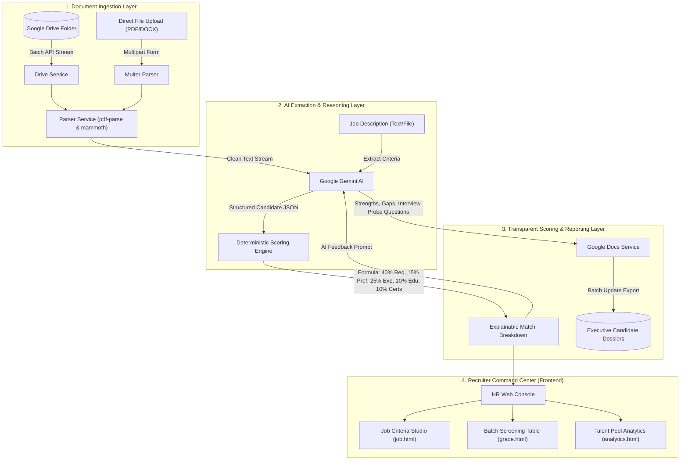

# 🎯 Resume Radar

> **AI-Powered Recruitment Analytics & Deterministic Candidate Matching Platform**
>
> Resume Radar accelerates talent screening by ingesting resumes directly from Google Drive, calculating transparent mathematical match scores against job requirements, generating executive Google Docs dossiers, and delivering real-time talent pool analytics—while keeping hiring decisions human-in-the-loop.

---

## 📌 Executive Summary

Recruiters managing high-volume talent pipelines receive hundreds of resumes per job opening. Manual screening is slow, inconsistent, and prone to fatigue and unconscious bias. At the same time, opaque black-box AI screeners reject qualified candidates without explainability or compliance guarantees.

**Resume Radar solves both challenges with a transparent hybrid approach:**
1. **Universal Multi-Format Ingestion:** Streams resumes directly from Google Drive or local file uploads (`.pdf`, `.docx`, `.doc`, `.txt`, and Google Docs).
2. **Schema-Enforced Gemini AI Parsing:** Maps unstructured resumes into validated JSON candidate profiles with model-fallback resilience.
3. **Transparent Mathematical Scoring Engine:** Eliminates black-box AI scores by calculating deterministic, auditable match points across 5 customizable categories.
4. **Automated Google Docs Recruitment Dossiers:** Generates executive scorecards, skill gap matrices, and tailored interview probe questions.
5. **Talent Pool Analytics Dashboard:** Interactive Chart.js visualizations showing score distributions, skill densities, and candidate comparisons.
6. **Human-in-the-Loop Review Checkpoints:** Recruiter audit trails for shortlisting, scheduling interviews, or constructive feedback.

---

## 🏛️ System Architecture



---

## 📐 The Deterministic Weighted Scoring Formula

To ensure compliance with hiring fairness and remove opaque bias, candidate scores are calculated using an explicit mathematical formula:

$$\text{Final Score} = (W_{req} \times S_{req}) + (W_{pref} \times S_{pref}) + (W_{exp} \times S_{exp}) + (W_{edu} \times S_{edu}) + (W_{cert} \times S_{cert})$$

### Default Category Weights:
- **Required Skills ($W_{req} = 0.40$):** Percentage of mandatory skills verified in the candidate profile, projects, or work history. Uses normalized alias mapping (e.g., `js` ↔ `javascript`, `react` ↔ `react.js`, `k8s` ↔ `kubernetes`).
- **Preferred Skills ($W_{pref} = 0.15$):** Bonus points for nice-to-have technologies.
- **Experience Alignment ($W_{exp} = 0.25$):** Ratio of verified professional years against job minimum (capped at 100%).
- **Education Tier ($W_{edu} = 0.10$):** Degree hierarchy alignment (High School = 1, Associate = 2, Bachelor's = 3, Master's = 4, Doctorate = 5).
- **Certifications / Credentials ($W_{cert} = 0.10$):** Verifies required domain credentials or relevant project portfolio evidence.

> **Explainability Guarantee:** Every evaluated candidate displays an auditable breakdown string:
> *"Match Score: 92.5% = (40/40 on Required Skills) + (7.5/15 on Preferred Skills) + (25/25 on Experience) + (10/10 on Education) + (10/10 on Certifications)"*

---

## 🛠️ Technology Stack

| Layer | Technologies | Role |
| :--- | :--- | :--- |
| **Backend Core** | Node.js (v18+), Express.js | High-throughput REST API server and middleware |
| **Document Parsers** | `pdf-parse`, `mammoth`, `multer` | Universal multi-format extraction from PDF, DOCX, and text |
| **AI Engine** | Google Gemini API (`@google/generative-ai`) | Structured JSON extraction, qualitative review, and interview probe questions |
| **Google Cloud** | Google Drive API (v3), Google Docs API (v1) | Batch resume ingestion and executive dossier report generation |
| **Frontend** | Vanilla HTML5, Modern CSS, JavaScript, Chart.js | Zero-build, responsive recruitment command center with dark/light mode |

---

## 🚀 Quick Start Guide

### 1. Prerequisites
- **Node.js** (v18 or higher) installed
- A **Google Gemini API Key** (from [Google AI Studio](https://aistudio.google.com/))
- *(Optional for Drive batch)* A Google Cloud Service Account JSON key

### 2. Environment Configuration
Create a `.env` file in the `backend/` directory:
```env
PORT=8080
GEMINI_API_KEY=your_gemini_api_key_here
GEMINI_MODEL=gemini-flash-lite-latest
GOOGLE_APPLICATION_CREDENTIALS=./service-account.json
MAX_FILES_DEFAULT=10
```

### 3. Launching Locally

#### On Windows (1-Click Startup):
Simply double-click `run.bat` or run:
```cmd
run.bat
```

#### Via Command Line:
```bash
cd backend
npm install
npm start
```
The application will launch on `http://localhost:8080`.

---

## 📁 Google Drive Service Account Setup

To batch-process candidate resumes directly from Google Drive:
1. Open the [Google Cloud Console](https://console.cloud.google.com/) and create a project.
2. Enable both the **Google Drive API** and **Google Docs API**.
3. Go to **IAM & Admin > Service Accounts**, create a Service Account, and create a **JSON Key**.
4. Save the downloaded key as `backend/service-account.json`.
5. Open your candidate resumes folder in Google Drive, click **Share**, and invite your Service Account's email address with **Viewer** or **Editor** permissions.
6. Copy the **Folder ID** from your browser URL and paste it into the Resume Radar screening console.

---

## 📡 REST API Reference

| Method | Endpoint | Description | Payload |
| :--- | :--- | :--- | :--- |
| `POST` | `/api` (or `/process-batch`) | Batch screen resumes from Google Drive | `{ inputFolderId, outputFolderId, maxFiles, jobCriteria, customWeights, generateDocs }` |
| `POST` | `/api/jobs/parse` | Extract structured criteria from JD text or file | `multipart/form-data` with `jobFile` OR `{ jobText: "..." }` |
| `POST` | `/api/candidates/screen-file` | Screen single uploaded resume file | `multipart/form-data` with `resumeFile`, `jobCriteria`, `customWeights` |
| `POST` | `/api/candidates/generate-report` | Generate on-demand Google Doc report | `{ candidateData, jobCriteria, outputFolderId }` |
| `POST` | `/api/candidates/review-status` | Update candidate decision | `{ candidateId, status: "shortlisted" | "rejected" | "interview_scheduled" | "hold" }` |
| `GET` | `/api/status` | System health and credentials check | Returns JSON status |
| `GET` | `/health` | Server liveness endpoint | `{ status: "ok" }` |

---

## 📄 License & Attribution

Developed by **Manav Patel** ([manav870](https://github.com/manav870)).
Built for modern talent teams seeking fast, fair, and explainable AI recruitment.
